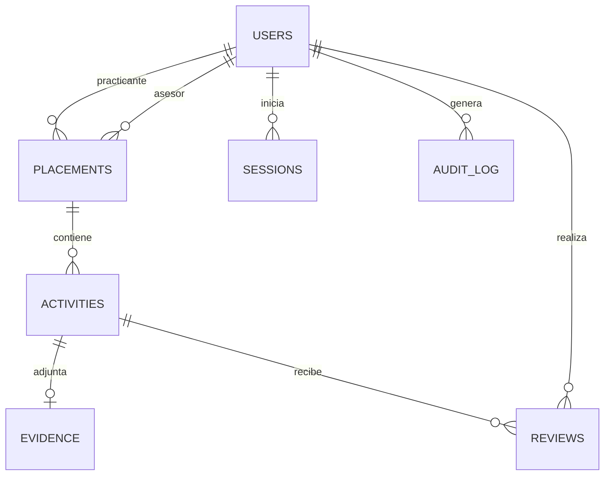

# Modelo y diccionario de datos

Motor: SQLite · Archivo: data/icasys.sqlite · Esquema reproducible: lib/schema.sql · Versión de esquema: 1.

## Relaciones

Un usuario tiene un rol único. Una estancia relaciona un practicante con un asesor; un usuario puede tener varias estancias. Cada actividad pertenece a una sola estancia. Cada actividad tiene cero o una evidencia actual y cero o muchas revisiones. No hay borrado en cascada de expedientes.

## users

| Columna | Tipo | Regla / significado |
|---|---|---|
| id | TEXT | UUID o identificador inicial; clave primaria |
| name | TEXT | Nombre del titular, obligatorio |
| email | TEXT | Obligatorio, único, NOCASE |
| role | TEXT | student, advisor o admin |
| password_hash | TEXT | Sal hexadecimal y derivación scrypt separadas por dos puntos |
| active | INTEGER | 1 activo / 0 inactivo |
| must_change | INTEGER | Obliga cambio de contraseña temporal |
| created_at | TEXT | Fecha y hora UTC de creación |

Las contraseñas se protegen con derivación criptográfica; no son cifradas de forma reversible. Las reglas de sintaxis y longitud se validan en servidor.

## placements

| Columna | Tipo | Regla / significado |
|---|---|---|
| id | TEXT | Clave primaria |
| student_id | TEXT | FK users.id; servidor exige perfil student activo |
| advisor_id | TEXT | FK users.id; servidor exige perfil advisor activo |
| school | TEXT | Institución educativa |
| project | TEXT | Nombre del proyecto |
| start / end | TEXT | Fechas ISO YYYY-MM-DD |
| target | REAL | Horas requeridas, mayor que 0 y hasta 2000; aplicación exige mínimo 1 |
| version | INTEGER | Versión de edición para evitar sobrescritura |
| created_at | TEXT | Registro UTC |

Índices por student_id y advisor_id para filtrar expedientes. El rol de las referencias y los periodos se verifican en la aplicación, además de las FK del motor.

## activities

| Columna | Tipo | Regla / significado |
|---|---|---|
| id | TEXT | Clave primaria |
| placement_id | TEXT | FK placements.id |
| title | TEXT | Nombre de actividad |
| description | TEXT | Trabajo y resultados |
| date | TEXT | Fecha de realización YYYY-MM-DD |
| hours | REAL | Entre 0.5 y 12; media hora mínima en aplicación |
| status | TEXT | draft, pending, correction, approved |
| version | INTEGER | Control de actualización y revisión |
| created_at / updated_at | TEXT | Marcas de tiempo UTC |

Índice por placement_id. Horas aprobadas = SUM(hours) con status='approved'. No hay campo acumulado independiente que pueda duplicarse al repetir una revisión.

## evidence

| Columna | Tipo | Regla / significado |
|---|---|---|
| activity_id | TEXT | PK y FK activities.id; un archivo actual por actividad |
| name | TEXT | Nombre original saneado |
| mime | TEXT | Tipo comprobado en servidor |
| content | BLOB | Bytes del archivo |
| size | INTEGER | Máximo 2097152 bytes |
| sha256 | TEXT | Huella del contenido |

No hay directorio público de archivos. La API valida acceso antes de devolver el BLOB. El hash es una huella, no una firma digital ni un análisis de seguridad del documento.

## reviews

| Columna | Tipo | Regla / significado |
|---|---|---|
| id | TEXT | Clave primaria |
| activity_id | TEXT | FK activities.id |
| reviewer_id | TEXT | FK users.id; autor real de la revisión |
| decision | TEXT | approved o correction |
| comment | TEXT | Comentario o motivo |
| created_at | TEXT | Momento UTC |

La revisión queda vinculada a quien la realizó, aunque después se reasigne el asesor de la estancia.

## sessions

| Columna | Tipo | Regla / significado |
|---|---|---|
| token_hash | TEXT | PK; SHA-256 del token de cookie |
| user_id | TEXT | FK users.id |
| csrf | TEXT | Token de protección de escrituras |
| expires_at | INTEGER | Vencimiento Unix en milisegundos |

Se eliminan sesiones al salir, cambiar o restablecer contraseña y desactivar la cuenta. Las sesiones vencidas no autorizan; se depuran al crear nuevas sesiones.

## login_attempts

key (TEXT PK) es el hash del correo o la dirección de conexión para limitar intentos; failures es el contador y reset_at el final de la ventana de 15 minutos. No contiene contraseñas.

## audit_log

id (INTEGER PK), user_id (FK users.id, opcional), action (TEXT), entity_id (TEXT, referencia operativa) y created_at (TEXT UTC). Conserva accesos y operaciones relevantes, sin copiar contraseñas o archivos. entity_id no es una FK porque se refiere a varias clases de entidad. La interfaz muestra los últimos 200 eventos; los anteriores permanecen en la base.

## Integridad y respaldo

PRAGMA foreign_keys=ON, journal_mode=WAL y busy_timeout=5000. Las operaciones compuestas se ejecutan con BEGIN IMMEDIATE / COMMIT o ROLLBACK. El esquema utiliza consultas preparadas y no concatena entradas de usuario en SQL. Las reglas que dependen del usuario, fecha o suma diaria se verifican en el servidor.

El esquema está principalmente normalizado: identidad en users, asignaciones en placements, hechos de trabajo en activities y revisiones separadas. El nombre del asesor y practicante se obtiene mediante JOIN, sin duplicarlo en cada actividad. Las evidencias actuales no tienen versionado histórico.
