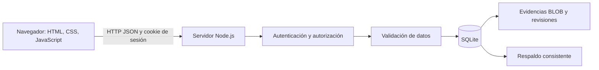
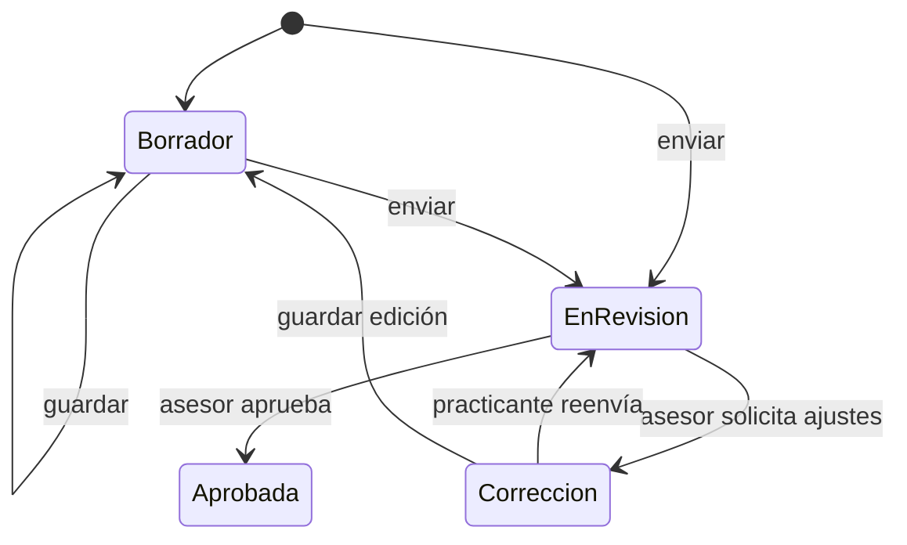

# Manual técnico

Sistema de seguimiento de prácticas profesionales ICASYS · Versión 2.0

## 1. Decisión tecnológica

Se eligió Node.js 24 porque la interfaz existente ya estaba construida en JavaScript y puede conservarse, el residente conoce esta tecnología y el entorno disponible permite ejecutar el sistema sin instalar dependencias adicionales. Se utiliza SQLite como motor relacional real, con claves foráneas, restricciones, índices, transacciones y persistencia en disco.

SQLite simplifica la instalación y el traslado para la evaluación académica. No se eligió por afirmar que sustituye cualquier infraestructura institucional: si aumenta significativamente el uso concurrente se deberá evaluar PostgreSQL o MySQL y adaptar la capa de persistencia. Las llamadas síncronas de SQLite son una limitación de escalabilidad del diseño actual. El transporte HTTP y el enrutamiento están implementados con módulos estándar de Node, sin framework externo.

Fuentes técnicas: https://nodejs.org/docs/latest-v24.x/api/sqlite.html y https://nodejs.org/docs/latest-v24.x/api/crypto.html. La implementación y las pruebas se ejecutaron con Node.js 24.19.0; los detalles de la API deben contrastarse con esa rama al mantener el proyecto.

## 2. Arquitectura

El navegador no contiene las contraseñas ni decide los permisos efectivos. app.js presenta los datos autorizados y realiza solicitudes a la API. server.cjs autentica, comprueba el rol y la asignación de la estancia, valida y ejecuta consultas parametrizadas. lib contiene persistencia, autenticación y validadores reutilizables. El modelo SQL está separado en lib/schema.sql.

## 3. Matriz de autorización

| Operación | Practicante | Asesor | Administrador |
|---|---|---|---|
| Consultar estancias | Propias | Asignadas | Todas |
| Consultar actividades | Propias | Asignadas, excepto borradores | Todas |
| Crear / editar actividades | Propias; edición solo borrador/corrección | No | No |
| Aprobar / pedir corrección | No | Solo asignadas y en revisión | No |
| Descargar evidencia | Propia | Asignada y entregada | Todas |
| Crear / editar estancias | No | No | Sí |
| Gestionar usuarios | No | No | Sí |
| Consultar auditoría | No | No | Sí |
| Cambiar contraseña propia | Sí | Sí | Sí |

La interfaz solo muestra opciones de su perfil, pero la barrera real está en el servidor. Alterar JavaScript o enviar IDs de otras estancias no concede autorización. Una cuenta inactiva pierde acceso y sus sesiones quedan revocadas. El administrador no aprueba horas: se mantiene la revisión con el asesor responsable.

## 4. Autenticación

- Correo único sin distinción entre mayúsculas y minúsculas.
- Contraseñas entre 12 y 128 caracteres con mayúscula, minúscula y número.
- Derivación mediante scrypt, sal aleatoria de 16 bytes y resultado de 64 bytes. La base guarda sal y derivación, nunca la contraseña recuperable.
- Comprobación con timingSafeEqual. Se deriva una contraseña ficticia también cuando la cuenta no existe.
- Token de sesión aleatorio de 32 bytes; SQLite guarda únicamente su hash SHA-256. Cookie HttpOnly, SameSite=Strict, Path=/ y duración máxima de ocho horas.
- COOKIE_SECURE=1 permite añadir Secure para una instalación HTTPS. La evaluación local utiliza HTTP en loopback.
- Token CSRF por sesión y validación de Origin para escrituras. No se habilita CORS.
- Diez intentos fallidos bloquean durante 15 minutos por origen de conexión y correo. Los contadores se conservan en base de datos.
- Al cambiar o restablecer contraseña se revocan las sesiones anteriores. El cambio de contraseña crea una sesión nueva.
- Contraseña inicial temporal obligatoria. Sin completarla solo se permiten consulta de sesión, cambio de contraseña y salida.

Las sesiones comparten cookie entre pestañas del mismo navegador y origen. No hay acceso simultáneo a tres perfiles mediante un selector. Se debe cerrar sesión o utilizar perfiles de navegador separados.

## 5. Reglas de actividades

Una actividad admite título de 1 a 120 caracteres, descripción de 15 a 3000, horas de 0.5 a 12 en pasos de 0.5 y fecha válida dentro de la estancia, no futura según America/Mexico_City. Las actividades enviadas de la misma estancia y fecha no superan 12 horas acumuladas; borradores no entran en ese cálculo. Estas reglas son propuestas de operación que ICASYS debe validar.

El campo version aumenta al modificar o revisar. Las solicitudes de actualización incluyen la versión consultada; una discrepancia responde 409 para evitar sobrescribir otra edición o revisar dos veces la misma entrega. Las escrituras y su auditoría se ejecutan en transacciones.

El avance es ROUND(horas aprobadas / meta × 100), limitado visualmente a 100%. Las horas reales no se recortan. Revisar dos veces no duplica registros de horas: el total se deriva de actividades con estado approved, no de sumas manuales acumuladas.

## 6. Evidencias y reportes

La carga utiliza JSON con contenido Base64 y un máximo de solicitud de 3 MB. Se limita cada archivo a 2 MB. Se valida nombre, extensión y firma básica de PDF, PNG y JPG, o texto UTF-8 sin bytes nulos para TXT. Esto no equivale a un análisis antivirus. Se almacena BLOB, MIME, tamaño y SHA-256 en evidence. La descarga pasa por autenticación y autorización, utiliza Content-Disposition: attachment y X-Content-Type-Options: nosniff.

Reemplazar una evidencia conserva únicamente la versión actual del archivo. El historial guarda decisiones y comentarios, no instantáneas de todos los textos o archivos anteriores. No hay eliminación de actividades en la interfaz.

CSV e impresión se generan en el navegador con los datos autorizados recibidos del servidor. CSV escapa comillas y prefija apóstrofo cuando una celda comienza con =, +, @ o -, para evitar la interpretación directa como fórmula. El PDF se obtiene con la impresión del navegador, no mediante un generador de documentos del servidor. No se incluyen firmas o validez oficial.

## 7. API

Todas las rutas devuelven JSON salvo la descarga de evidencias. Las escrituras utilizan Content-Type: application/json, Origin del mismo servidor y X-CSRF-Token (excepto login, que no exige token CSRF pero sí Origin). Los ejemplos describen estructura, no contienen contraseñas reales.

| Método y ruta | Función | Campos principales |
|---|---|---|
| POST /api/login | Ingreso | email, password |
| GET /api/session | Sesión actual | Devuelve user y csrf |
| POST /api/logout | Salida | Sin cuerpo obligatorio |
| POST /api/password | Cambio de contraseña | current, password |
| GET /api/state | Expediente autorizado | user, placements, activities y users (solo admin) |
| POST /api/users | Nueva cuenta | name, email, role, password |
| PUT /api/users/:id | Editar / desactivar / restablecer | name, email, active, password opcional |
| POST /api/placements | Nueva estancia | student_id, advisor_id, school, project, start, end, target |
| PUT /api/placements/:id | Actualizar estancia | Campos anteriores y version |
| POST /api/activities | Registro de actividad | placement, title, description, date, hours, status, evidence opcional |
| PUT /api/activities/:id | Editar y reenviar | Campos de actividad y version |
| POST /api/activities/:id/review | Revisar actividad | status, comment, version |
| GET /api/evidence/:activityId | Descargar evidencia | Cookie de sesión |
| GET /api/audit | Últimos 200 eventos | Solo administrador |

status usa draft/pending para entregas y approved/correction para revisiones. evidence al cargar es {name, url: data:MIME;base64,...}; una edición puede mantener la referencia /api/evidence/ID recibida previamente.

Errores: 400 JSON inválido; 401 sin sesión o credenciales incorrectas; 403 permiso, origen o CSRF; 404 inexistente; 409 conflicto de versión, estado o duplicado; 413 tamaño; 415 tipo de contenido; 422 validación; 429 intentos de ingreso; 500 error interno sin exponer detalles SQL.

## 8. Operación y mantenimiento

El servidor expone index.html, app.js, styles.css, el logotipo y el expediente de documentación por una lista explícita. Código de servidor, bases, respaldos y accesos no se publican. Respuestas no se cachean. Se incluyen CSP y protección contra enmarcado; la política permite el estilo en línea usado por la interfaz y las fuentes externas de Google Fonts.

Las claves foráneas están activas y SQLite usa WAL y busy_timeout. Las evidencias están dentro de la misma base para que el respaldo capture un expediente completo. backup.cjs usa la API de respaldo de SQLite; no basta copiar un archivo activo ignorando el WAL.

Limitaciones conocidas: sin recuperación de contraseña por correo, MFA, verificación de correo, notificaciones, antivirus, auditoría externa inmutable, pruebas de alta carga o despliegue público. SQLite y scrypt usan operaciones síncronas en algunos caminos; se debe evaluar su desempeño antes de aumentar la escala. El archivo de base de datos no está cifrado en reposo. El control de acceso del sistema operativo y la protección de respaldos son parte de la operación.
